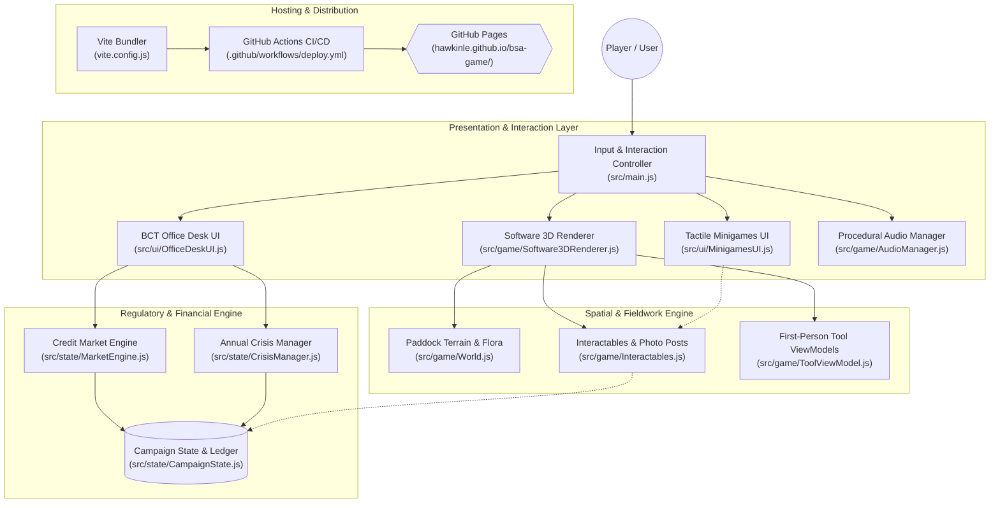

# System Architecture

The Biodiversity Stewardship Simulator is structured as a client-side web application built in vanilla ES modules bundled with Vite. The game separates regulatory financial logic from real-time spatial simulation, ensuring that regulatory state calculations remain deterministic and testable independently of rendering performance.

State lives primarily in singleton state engines located in `src/state/`. The central [`CampaignState`](modules/campaign-state.md) maintains the statutory financial accounts (TFD balance, AMP account), regulatory trust score, inventory pools, and 5-year progression timeline. The [`MarketEngine`](modules/market-engine.md) operates on this state to simulate credit market liquidity, while [`CrisisManager`](modules/crisis-manager.md) drives the narrative arc through seasonal environmental disruptions and inspector audits.

The presentation layer is bifurcated between a 3D first-person field view and a 2D management desk. The 3D view is rendered through a dedicated Canvas2D [`Software3DRenderer`](modules/software-renderer.md) capable of running reliably on systems without hardware WebGL acceleration. Real-time field interaction (weeding, spraying, photo monitoring) is bridged into tactile minigames via [`MinigamesUI`](modules/minigames-ui.md), and higher-level regulatory management is handled by [`OfficeDeskUI`](modules/office-desk-ui.md).

## Components

- **[`CampaignState`](modules/campaign-state.md)** — Core data model and persistence coordinator for statutory balances, credit inventory, and audit milestones.
- **[`MarketEngine`](modules/market-engine.md)** — Dynamic order book that generates commercial bids from diverse buyer personas and executes credit transactions.
- **[`CrisisManager`](modules/crisis-manager.md)** — Scenario director managing annual environmental challenges (flood, fire, species surveys) and compliance audits.
- **[`Software3DRenderer`](modules/software-renderer.md)** — Perspective software projection engine rendering terrain, billboarding flora, wire fences, and 3D tool models on a Canvas2D context.
- **[`PaddockWorld`](modules/paddock-world.md)** — Spatial world representation managing procedural heightmaps, tree placement, weed infestation nodes, and photo monitoring posts.
- **[`OfficeDeskUI`](modules/office-desk-ui.md)** — DOM-based desktop dashboard with tabs for 5-Year Campaign, Credit Market, Site Map, Supplies, and BCT Audits.
- **[`MinigamesUI`](modules/minigames-ui.md)** — Interactive timing and pressure gauges for manual field activities (mattock root-popping and knapsack sprayer pressure).
- **[`AudioManager`](modules/minigames-ui.md)** — Synthesized Web Audio API sound generator providing procedural spatial audio and UI feedback without external audio assets.

## System Diagram

## Data Flow

1. **Player Field Action** — Player approaches an interactable node (e.g. Serrated Tussock) and triggers action via [`src/main.js`](../../src/main.js).
2. **Minigame Engagement** — [`src/ui/MinigamesUI.js`](../../src/ui/MinigamesUI.js) launches an oscillating sweet-spot root-pop ring or consumes knapsack chemical pressure.
3. **Inventory & Target Update** — Upon minigame completion, [`src/game/Interactables.js`](../../src/game/Interactables.js) applies damage or captures photo point data and updates consumable counts in [`src/state/CampaignState.js`](../../src/state/CampaignState.js).
4. **Market Trading** — Player opens Office Desk (`O` key) via [`src/ui/OfficeDeskUI.js`](../../src/ui/OfficeDeskUI.js) and navigates to the Credit Market tab.
5. **Credit Settlement** — [`src/state/MarketEngine.js`](../../src/state/MarketEngine.js) calculates proceeds; 100% of proceeds automatically fund the Total Fund Deposit account until reaching $850,000, after which surplus funds flow to operational cash.
6. **Annual Audit & Transition** — [`src/state/CrisisManager.js`](../../src/state/CrisisManager.js) evaluates completed tasks, environmental breaches, and crisis resolution status to compute Inspector Henderson's trust score and advance the 5-year timeline.

## Key Design Decisions

- **Canvas2D Software 3D Fallback**: Rather than depending strictly on WebGL hardware contexts (which can crash or fail on constrained Linux sandboxes and older mobile devices), the engine features a pure Canvas2D software projection pipeline that renders ground grids, 3D billboarding trees, and tool viewmodels at a constant 60 FPS.
- **Accurate Statutory BCT/BOS Modeling**: TFD capitalization rules enforce NSW statutory requirements: landholders cannot take profit dividends until the full statutory management fund ($850,000) is locked into the BCT trust.
- **Zero External Runtime Assets**: All 3D assets (trees, fences, Hilux regulator truck, tools) and sound effects are generated procedurally using canvas rasterization and the Web Audio API, minimizing asset load latency and eliminating 404 resource errors.
- **Relative Path Bundling for GitHub Pages**: Vite is configured with `base: './'`, enabling frictionless hosting under arbitrary subdirectory paths (`/bsa-game/`) on GitHub Pages without asset path breakage.
