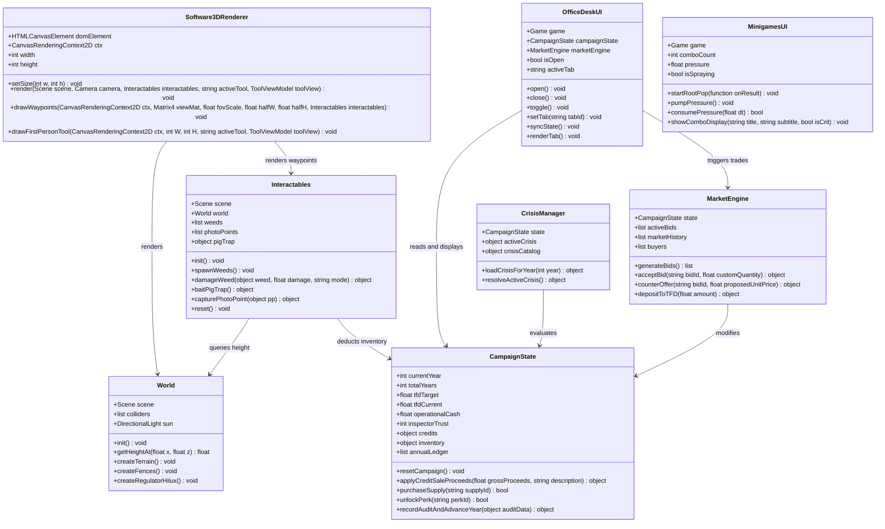

# Class Diagram

## Core Types and Relationships

## Notes

- **Separation of Simulation & Rendering**: `CampaignState` and `MarketEngine` have zero dependencies on Canvas or DOM libraries, enabling headless automated unit testing.
- **UI State Synchronization**: `OfficeDeskUI` reads directly from `CampaignState` and calls `syncState()` every time the player presses `O`, guaranteeing that financial balances and market order books always reflect real-time transactions.
