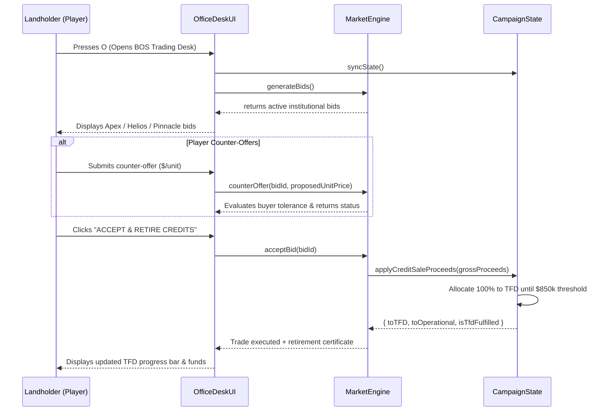
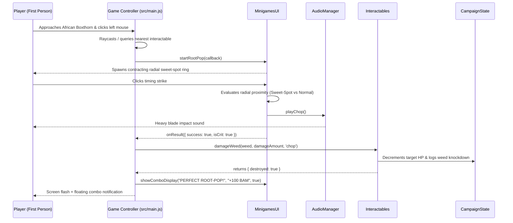
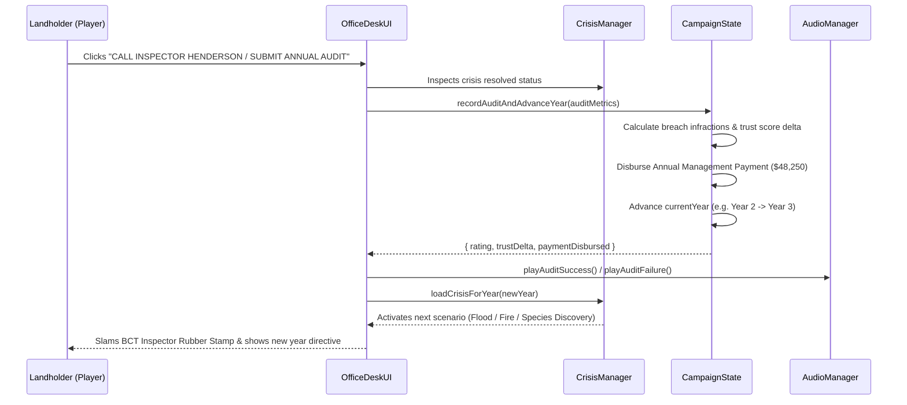
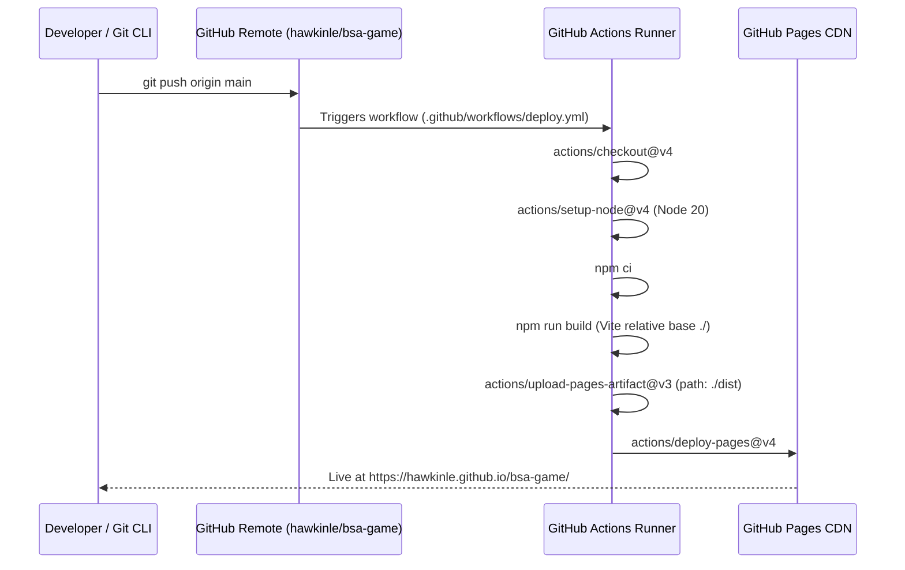

# Sequence Diagrams

## Workflow 1: Biodiversity Credit Negotiation and Statutory Settlement

This workflow traces the credit trading process from viewing buyer bids on the BOS order book to calculating proceeds, allocating capital to the BCT Total Fund Deposit, and issuing transaction certificates.

### Walkthrough

1. **Desk Activation** — [`src/ui/OfficeDeskUI.js:OfficeDeskUI.open`](../../../src/ui/OfficeDeskUI.js)
2. **Order Generation** — [`src/state/MarketEngine.js:MarketEngine.generateBids`](../../../src/state/MarketEngine.js)
3. **Price Negotiation** — [`src/state/MarketEngine.js:MarketEngine.counterOffer`](../../../src/state/MarketEngine.js)
4. **Statutory Allocation** — [`src/state/CampaignState.js:CampaignState.applyCreditSaleProceeds`](../../../src/state/CampaignState.js)

---

## Workflow 2: Tactile Fieldwork and Weed Eradication Loop

This workflow traces the real-time first-person interaction when a player identifies an invasive woody weed, engages the root-pop sweet-spot minigame with the mattock, and updates paddock ecological condition.

### Walkthrough

1. **Raycast Detection** — [`src/main.js:Game.useActiveTool`](../../../src/main.js)
2. **Minigame Timing** — [`src/ui/MinigamesUI.js:MinigamesUI.startRootPop`](../../../src/ui/MinigamesUI.js)
3. **Sound Synthesis** — [`src/game/AudioManager.js:AudioManager.playChop`](../../../src/game/AudioManager.js)
4. **Target Mutation** — [`src/game/Interactables.js:Interactables.damageWeed`](../../../src/game/Interactables.js)

---

## Workflow 3: Annual BCT Compliance Audit and Timeline Progression

This workflow illustrates how end-of-year audits evaluate completed paddock duties, penalize unaddressed environmental crises, update trust ratings, and release annual management payments.

### Walkthrough

1. **Audit Invocation** — [`src/ui/OfficeDeskUI.js:OfficeDeskUI.renderAuditHistoryView`](../../../src/ui/OfficeDeskUI.js)
2. **Statutory Evaluation** — [`src/state/CampaignState.js:CampaignState.recordAuditAndAdvanceYear`](../../../src/state/CampaignState.js)
3. **Crisis Sequencing** — [`src/state/CrisisManager.js:CrisisManager.loadCrisisForYear`](../../../src/state/CrisisManager.js)

---

## Workflow 4: GitHub Pages Automated Build and Deployment Pipeline

This workflow describes the deployment path from local commit to GitHub Actions build, artifact generation, and deployment on GitHub Pages.

### Walkthrough

1. **Vite Build Configuration** — [`vite.config.js`](../../../vite.config.js)
2. **GitHub Actions Workflow** — [`.github/workflows/deploy.yml`](../../../.github/workflows/deploy.yml)
